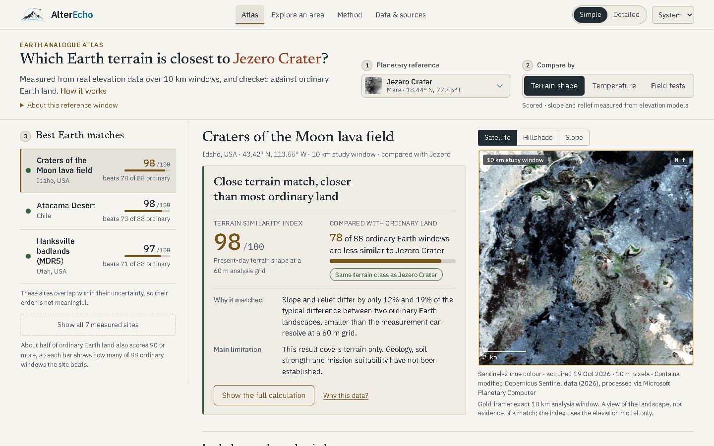
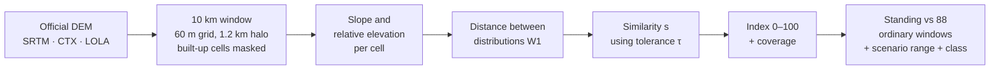
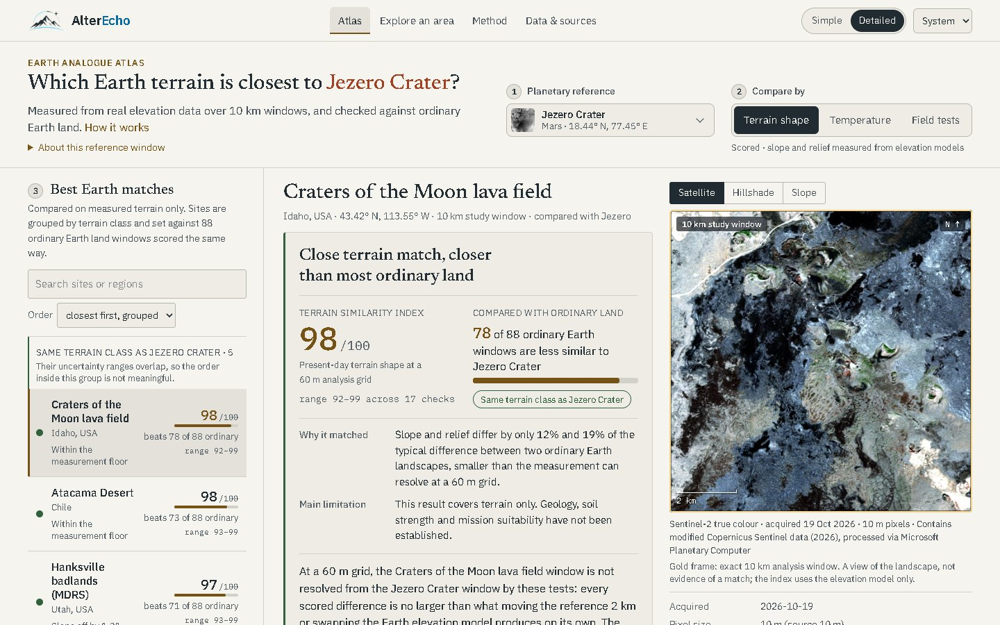
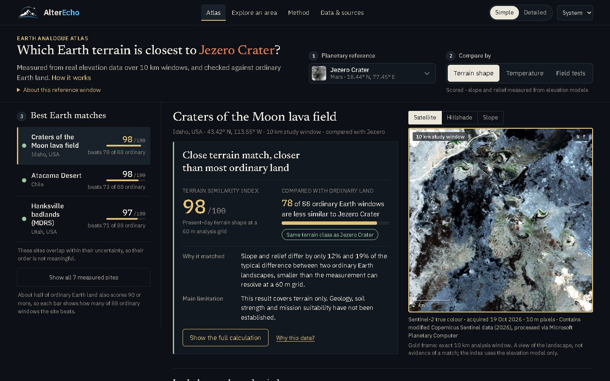

<p align="center">
  
</p>

<h1 align="center">AlterEcho</h1>

<p align="center">
  <strong>Find the places on Earth whose terrain echoes Mars and the Moon, and see exactly how sure we can be.</strong>
</p>

<p align="center">
  🌍 <strong>Live site: <a href="https://alterecho.earth">alterecho.earth</a></strong><br>
  📄 <a href="docs/paper/methods.pdf">Research paper (PDF)</a> ·
  <a href="docs/paper/methods.docx">Word</a> ·
  <a href="docs/paper/methods.md">Markdown</a> ·
  <a href="docs/ALTERECHO_SYSTEM_AND_RESEARCH_GUIDE.pdf">System &amp; research guide</a>
</p>

<p align="center">
  NASA Space Apps Challenge 2026 · <em>Identify Earth locations that analog the permanent Moon base locations and Mars</em><br>
  Team members: <strong>Sarbagya Acharya</strong>, <strong>Bikash Pandey</strong>, <strong>Saurav Shah</strong>, <strong>Neharika Acharya</strong>
</p>

---



## What is AlterEcho?

Before astronauts or rovers go to Mars or the Moon, scientists test their tools and methods in places on Earth that look and behave like those worlds. These places are called **analogues**. People often call a desert "Mars-like" because it looks dusty and red. AlterEcho tries to answer that question with measurements instead.

You pick a real location on Mars or the Moon, for example Jezero Crater, where the Perseverance rover is exploring. AlterEcho then compares the shape of the ground there with registered 10 km windows on Earth. It uses real elevation data from NASA, USGS and ESA and one transparent formula, and it gives three answers:

1. **Which Earth sites are closest**, as a 0–100 terrain similarity index.
2. **How special that is.** For example: "closer to Jezero than 78 of 88 ordinary Earth land windows."
3. **What the result cannot tell you.** That includes uncertainty ranges, ties the data cannot separate, and everything that was not measured.

Every number on the site can be traced to the exact data file it came from, using its checksum. The browser never invents or recomputes a score.

> **Please read this as a research shortlisting tool.** AlterEcho compares terrain shape at a 60 m grid. It is not a landing-site selector, not a safety assessment, not a measure of geology or habitability, and not a NASA endorsement.

---

## Contents

- [Try it in one minute](#try-it-in-one-minute)
- [How to use the website](#how-to-use-the-website)
- [What the results say today](#what-the-results-say-today)
- [How to read a result](#how-to-read-a-result)
- [How the calculation works](#how-the-calculation-works-analogue-method-v10)
- [Worked example: Atacama Desert vs Jezero Crater](#worked-example-atacama-desert-vs-jezero-crater)
- [What AlterEcho does not claim](#what-alterecho-does-not-claim)
- [Study sites and data](#study-sites-and-data)
- [Run it on your own computer](#run-it-on-your-own-computer)
- [API quick reference](#api-quick-reference)
- [Project structure](#project-structure)
- [Tests and verification](#tests-and-verification)
- [Reproduce the data](#reproduce-the-data)
- [Deployment](#deployment)
- [Security](#security)
- [Documents and resources](#documents-and-resources)
- [Sources and attribution](#sources-and-attribution)
- [Team](#team)

---

## Try it in one minute

1. Open **[alterecho.earth](https://alterecho.earth)**.
2. The atlas opens on **Jezero Crater (Mars)**, comparing by **Terrain shape**, in **Simple** view.
3. Look at the **three best Earth matches** on the left. The leading one is already open on the right, beside a satellite image of its exact 10 km study window.
4. Read the two short lines under the score: **Why it matched** and **Main limitation**.
5. Click **Detailed** (top right) or **Show the full calculation** to see every formula, table, data source and download.

That's the whole idea. The rest of this README explains each piece.

---

## How to use the website

### The atlas (home page) in three steps

| Step | What you do | What happens |
|---|---|---|
| **1. Planetary reference** | Open the dropdown and choose a location on Mars or the Moon. | Every Earth site is measured against that window. |
| **2. Compare by** | Choose **Terrain shape**, **Temperature** or **Field tests**. | Terrain shape is scored. Temperature and Field tests are shown as context only and never change a score. |
| **3. Best Earth matches** | Click any site in the list. | Its result card, satellite image and study window open on the right. |

The six planetary references are:

| Reference | Body | Why it is here |
|---|---|---|
| Jezero Crater | Mars | Perseverance rover landing site; ancient lake delta |
| Gale Crater floor (Aeolis Palus) | Mars | Curiosity rover; ancient lake environment |
| Elysium Planitia (InSight site) | Mars | Very smooth, flat lava plains |
| Gusev crater plains (Spirit site) | Mars | Spirit rover; cratered volcanic plains |
| Eberswalde crater delta | Mars | One of the clearest ancient river deltas on Mars |
| Lunar south pole (Shackleton rim) | Moon | Candidate region for a permanent Moon base. **Distances only** (see [below](#why-the-moon-shows-distances-but-no-index)) |

### Simple and Detailed views

- **Simple** (the default) shows only what you need to make a decision: the top three sites, one score, how many ordinary Earth windows that site beats, why it matched and its main limitation. Click **Show all measured sites** to see the rest.
- **Detailed** adds the full ranked list with search and sort, scenario ranges, the distribution charts, every formula with its numbers filled in, provenance and checksums, a printable report and a JSON download.

Switching views never loses your place. The reference, site and comparison all stay as they were.

### Look closer at a study window

Below each result there are three views:

1. **Compare with reference** shows the Earth window and the planetary window side by side at the same scale.
2. **3D terrain** shows the real elevation grid used for the score, in 3D, with 1×, 2× or 4× vertical exaggeration. You can show the reference surface next to it on one shared vertical scale.
3. **Interactive map** is a zoomable map with the 10 m Sentinel-2 image, hillshade and slope layers. It needs internet for the NASA background tiles. If those tiles fail, a small "Background map offline · Retry" note appears and the study-window image is still shown.

The still image on the result card is served by AlterEcho itself, so it always loads, even when outside map services are down.

### Other pages

| Page | What it's for |
|---|---|
| **Explore an area** | Screen any Earth point between 56° S and 60° N with the same method. Results are *screening records* and are never added to the atlas. Runs on a local or GDAL-capable server only (see [Deployment](#deployment)). |
| **Method** | The full method in plain language: formulas, tolerances, resolution floor, discrimination checks and planned future work. |
| **Data & sources** | Every dataset, its role (scored, quality mask, display only or context), official link, licence and local checksum. |
| **Report** | A printable view of one stored comparison. |

### Shareable links

The address bar always describes what you see, so links, reloads and the browser's back and forward buttons all agree.

```
https://alterecho.earth/?reference=mars-jezero&site=earth-atacama-south&compare=terrain&view=full
```

| Parameter | Values |
|---|---|
| `reference` | `mars-jezero`, `mars-gale-aeolis-palus`, `mars-insight-elysium`, `mars-gusev-plains`, `mars-eberswalde-delta`, `moon-south-pole-shackleton` |
| `site` | an Earth site ID, for example `earth-craters-of-the-moon`, `earth-atacama-south`, `earth-hanksville-mdrs`, `earth-meteor-crater`, `earth-danakil` |
| `compare` | `terrain`, `temperature`, `fieldwork` |
| `view` | `simple` or `full` (Detailed) |

The site also offers a dark and a light theme, works on phones (the menu folds away), can be used fully with the keyboard and respects your system's reduced-motion setting.

---

## What the results say today

### Terrain shape vs Jezero Crater

| Earth site | Index | Ordinary windows beaten (of 88) | Scenario range | Terrain class |
|---|---|---|---|---|
| Craters of the Moon lava field, USA | 98.2 | 78 | 92–99 | same |
| Atacama Desert, Chile | 97.9 | 73 | 93–99 | same |
| Hanksville badlands (MDRS), USA | 97.4 | 71 | 93–99 | same |
| Meteor Crater (Barringer), USA | 95.1 | 58 | 85–98 | same |
| Dallol, Danakil Depression, Ethiopia | 88.6 | 44 | 77–94 | same |
| Upper Mustang, Nepal | 0.6 | 9 | 0–4 | different |
| Ladakh, India | 0.0 | 6 | 0–0 | different |

**How to read this table:** the top five share one terrain class and their scenario ranges overlap, so **the data cannot put them in order**. Craters of the Moon and Atacama are not even resolved from Jezero by the floor tests (moving the reference 2 km, or swapping DEM products). Upper Mustang and Ladakh are mountain terrain and clearly different from Jezero's low-relief crater floor.

### Best match for every reference

| Reference | Leading Earth site | Index | Ordinary windows beaten (of 88) | Background windows scoring 90 or more |
|---|---|---|---|---|
| Jezero Crater | Craters of the Moon | 98.2 | 78 | 49% |
| Gale Crater floor | Meteor Crater | 99.4 | 79 | 44% |
| Elysium Planitia (InSight) | Atacama Desert | 98.4 | 83 | 47% |
| Gusev crater plains | Meteor Crater | 97.2 | 79 | 42% |
| Eberswalde delta | Atacama Desert | 98.3 | 86 | 46% |
| Lunar south pole | distances only, no index | n/a | n/a | n/a |

Against every Mars reference, the five low-relief Earth sites form one tie group and the two Himalayan sites are in the "different" class. These numbers come straight from the running API (`/api/v3/compare`). A regression test fails if the paper and the API ever disagree.

---

## How to read a result

| You see | It means | It does **not** mean |
|---|---|---|
| **Index 97.9** | The slope and relative-elevation distributions of the two 10 km windows are very close at a 60 m grid. | "97.9 % like Mars", a probability, or a confidence level. |
| **Closer than 73 of 88 ordinary windows** | Of 88 unselected Earth land windows scored the same way, 73 score lower. **This is the most useful number.** | That the other 15 windows are bad analogues. |
| **Same terrain class** | Both scored differences are smaller than the difference between two typical Earth landscapes. | That the geology or history is the same. |
| **Scenario range 93–99** | The index recomputed under 17 reasonable changes (window moved 2 km, other DEM, coarser grid, tolerances ±25 %, other weights). | A statistical confidence interval. |
| **Tie / "order not meaningful"** | The ranges overlap, so the data cannot separate these sites. | A display bug. It is an honest result. |
| **Not resolved from the reference** | Every difference is at or below what moving the window 2 km or swapping DEM products produces by itself. | Proof that the surfaces are identical. |
| **Coverage 100 %** | All planned evidence for the *terrain-only* profile was measured. | Statistical confidence. |

**Why the standing matters:** about **half of all ordinary Earth land scores 90 or more** against each Mars reference. A high index on its own therefore only says "low-relief terrain". The standing tells you whether a site is distinctive.

---

## How the calculation works (analogue-method-v1.0)

AlterEcho asks one narrow, repeatable question:

> *At a 60 m grid, how closely do the distributions of slope and relative elevation in a 10 km Earth window match those in a 10 km Mars or Moon window? And is that match bigger than what the measurement itself can resolve?*

Every result depends on its full definition:

```math
\mathcal{Q} = (E,\,P,\,T,\,H,\,V,\,R)
```

Here $E$ is the Earth window, $P$ the planetary window, $T$ the task profile, $H$ the epoch (today's surface), $V$ the method version and $R$ the profile configuration. Results with different definitions are never ranked together.



### Step 1: Prepare the windows

- Each DEM is resampled onto a north-up metric grid centred on the window: UTM on Earth, local equirectangular on Mars, polar stereographic on the Moon.
- The main grid is **60 m (167 × 167 cells)**. Grids of 120 m and 240 m are used only as sensitivity checks.
- A **1200 m halo** is processed around the window so the edge cells have complete neighbourhoods. Only core cells are counted.
- Missing data stay missing and are never filled. On Earth, cells that are **at least 50 % built-up** in ESA WorldCover are removed.
- A feature counts only if **at least 90 % of core cells are valid** in both windows.

### Step 2: Measure the terrain

**Slope** (in degrees), from central differences on the metric grid:

```math
\theta = \arctan\sqrt{\left(\frac{\partial z}{\partial x}\right)^{2} + \left(\frac{\partial z}{\partial y}\right)^{2}}
```

**Relative elevation** (in metres). Earth, Mars and the Moon measure height from different zero levels, so each window is compared to its own median:

```math
z_{\mathrm{rel}} = z - \mathrm{median}(z)
```

Local relief (1020 m neighbourhood) and roughness (300 m neighbourhood) are also measured and shown, but they are **not scored**. Across 88 windows they move almost in lockstep with slope (Spearman ρ = 0.985 and 0.998), so scoring them would count the same thing three times. Relative elevation is independent of slope (ρ = −0.244), so slope and relative elevation are the two scored features.

### Step 3: Distance between the two distributions

For each feature $k$, AlterEcho compares the whole distribution of values across the window, not just an average. It uses the 1-D **Wasserstein-1 distance**: the average gap between matching quantiles of the two windows, in degrees or metres.

```math
d_{k} = W_{1}\!\left(F_{E,k}, F_{P,k}\right) = \int_{0}^{1} \left| F_{E,k}^{-1}(u) - F_{P,k}^{-1}(u) \right| \mathrm{d}u
```

In the code this is evaluated with the midpoint rule on 500 quantiles:

```math
\hat{d}_{k} = \frac{1}{N}\sum_{i=1}^{N} \left| Q_{E,k}(u_{i}) - Q_{P,k}(u_{i}) \right|, \qquad u_{i} = \frac{i - \tfrac{1}{2}}{N}, \quad N = 500
```

For the worked example this differs from the exact all-cell distance by only 0.06 %.

### Step 4: Turn the distance into a similarity

```math
s_{k} = \exp\!\left[-\ln 2\,\left(\frac{d_{k}}{\tau_{k}}\right)^{2}\right] = 2^{-(d_k/\tau_k)^2}
```

The **tolerance τ** is "how different two ordinary Earth landscapes usually are". It is the median distance over all 3,828 pairs of 88 unselected Earth land windows:

```math
\tau_{k} = \underset{i<j}{\mathrm{median}}\; W_{1}\!\left(F_{i,k}, F_{j,k}\right)
\qquad\Rightarrow\qquad
\tau_{\mathrm{slope}} = 5.8058^\circ,\quad \tau_{\mathrm{rel}} = 77.1038\ \mathrm{m}
```

| Difference $d/\tau$ | 0 | 0.25 | 0.5 | 1 | 1.5 | 2 |
|---|---|---|---|---|---|---|
| Similarity $s$ | 1.000 | 0.958 | 0.841 | **0.500** | 0.210 | 0.0625 |

In words: if a site differs from the reference as much as two typical Earth landscapes differ from each other, it gets half marks on that feature.

### Step 5: Combine the features

```math
S_{g} = \sum_{k} a_{k|g}\, s_{k}, \qquad a_{\mathrm{slope}} = a_{\mathrm{rel}} = 0.5
```

The terrain family is scored only if **every** scored feature is eligible. A family is never scored from half its features.

### Step 6: Check what the data can resolve (the resolution floor)

Some difference appears even when nothing about the terrain changes. Moving the window a little, or switching to another elevation product, produces it on its own. AlterEcho measures that floor:

```math
\delta_{k} = \sqrt{\delta_{\mathrm{place},k}^{2} + \delta_{\mathrm{dem},k}^{2}}
```

- $\delta_{\mathrm{place}}$ is the largest distance between the reference window and the same window moved 2 km north, south, east or west.
- $\delta_{\mathrm{dem}}$ is the largest distance between SRTM and NASADEM or Copernicus GLO-30 for the same Earth window (15 pairs).
- For Jezero this gives $\delta_{\mathrm{slope}} = 1.1708^\circ$ and $\delta_{\mathrm{rel}} = 22.1523$ m.

**Rule:** a feature is scored only if $\tau_k \ge 3\,\delta_k$. The floor never changes a similarity. It decides eligibility and wording: if every difference is at or below its floor, the site is "not resolved from the reference by these tests".

#### Why the Moon shows distances but no index

Moving the lunar south-pole window by 2 km changes its relative elevation by about **195 m**, against a 77 m tolerance. That fails the 3× rule, so lunar comparisons show the measured distances honestly but give no index and no ranking.

### Step 7: The index and evidence coverage

```math
A_{\mathrm{obs}} = 100 \times \frac{\sum_{g} w_{g} I_{g} S_{g}}{\sum_{g} w_{g} I_{g}}
\qquad\qquad
C = \sum_{g} w_{g} I_{g}
```

- $w_g$ is the planned weight of evidence family $g$, and $I_g$ is 1 if that family is eligible.
- If nothing qualifies, the index is **undefined, never 0**.
- Only terrain is measured today, so $C = 1$ for the terrain profile. The other task profiles (balanced science 0.30, rover mobility 0.80, Mars-base field testing 0.35) are shown as *partial* and are never ranked.

### Step 8: Standing, class and ties

**Standing among ordinary land** is how many of the 88 background windows $b$ score lower than candidate $c$ against the same reference:

```math
N_{\mathrm{closer}} = \#\{\, b : A_b < A_c \,\}
```

**Terrain class** is decided from both scored features:

- **same**: every scored $d_k < \tau_k$
- **different**: every scored $d_k \ge \tau_k$
- **partial**: one of each

**Ties:** each index is recomputed under 17 scenarios:

- the Earth window moved 2 km in each of four directions
- the reference window moved 2 km in each of four directions
- each alternative DEM
- the 120 m and 240 m grids
- τ × 0.75 and τ × 1.25
- feature weights 0.25/0.75

Sites whose ranges overlap are chained into one group and share a rank. These ranges are sensitivities, not confidence intervals.

---

## Worked example: Atacama Desert vs Jezero Crater

The Atacama window `earth-atacama-south-aoi-v1` is centred at 24.2722° S, 69.9005° W (SRTMGL1, UTM 19S, 0.00 % built-up cells). It is compared with `mars-jezero-aoi-v1` (Mars 2020 CTX DEM) under the terrain profile.

| Feature | Atacama | Jezero | $d$ | $\tau$ | $d/\tau$ | $s$ | Floor $\delta$ |
|---|---|---|---|---|---|---|---|
| Slope | 2.69° median, 6.22° p90 | 1.83° median, 5.24° p90 | 0.8225° | 5.8058° | 0.14167 | 0.986185 | 1.1708° |
| Relative elevation | −80.2 to 44.9 m (p10–p90) | −58.9 to 105.9 m (p10–p90) | 15.6373 m | 77.1038 m | 0.20281 | 0.971893 | 22.1523 m |

You can check it by hand:

```math
s_{\mathrm{slope}} = 2^{-(0.14167)^2} \approx 0.986185, \qquad s_{\mathrm{rel}} = 2^{-(0.20281)^2} \approx 0.971893
```

(Using the rounded ratios shown here, the last digit can differ by one. The table values come from full precision.)

```math
S_g = 0.5 \times 0.986185 + 0.5 \times 0.971893 = 0.979039 \quad\Rightarrow\quad A_{\mathrm{obs}} = 97.90
```

**What it means:**

- Both differences are below their floors, so Atacama is *not resolved* from Jezero by these tests.
- Across 17 scenarios the index ranges from **93.1 to 98.7**, and the site shares rank 1 with four other low-relief windows.
- **15 of 88** ordinary windows (17 %) score at least as high, so the site beats 73.
- Conclusion: Atacama and Jezero share low-relief terrain at this scale. That says nothing about geology, habitability or whether a base or landing would be safe.

The backend and an independent recomputation agree to within 10⁻⁹ index points, and `backend/tests/test_paper_numbers.py` fails if the paper ever drifts from the API.

---

## What AlterEcho does not claim

We would rather show an honest "we can't tell" than a confident wrong number.

- **High scores are common.** 42–49 % of ordinary Earth windows score 90 or more against each Mars reference. The index separates low-relief from rugged terrain but cannot order low-relief sites. Always read the standing.
- **Distributions ignore spatial arrangement.** A synthetic gentle 300 m fractal surface scores 88.4 against Jezero. A 15° tilted plane scores 2.1, and an exact copy of Jezero scores 100.0.
- **Only terrain is scored.** Geology and minerals (EMIT, CRISM), water and ice, surface processes, subsurface, habitability, access and mission safety are **not** assessed.
  - Temperature fails the comparability audit (different spatial and time support), so it is shown side by side only.
  - Field-test suitability is a literature record, never a number.
- **The tolerances are project definitions,** not fitted to expert labels. Leaving one region out moves τ for slope between 3.68° and 9.42°. The order of the five leading sites does not change when that happens.
  - The 88 background windows come from **4 regions** and are spatially correlated, so they are not 88 independent samples.
  - The candidate sites were known beforehand, so this is **not a blind test**.
- **Data quirks:**
  - CTX stereo noise inflates slopes on very smooth plains (InSight median 3.1°).
  - The Gale window's south-east corner includes part of a dark-toned band.
  - Copernicus GLO-30 was not measured for Meteor Crater because of a provider rate limit.
  - The Ladakh image is about 12 months old, and its legend says so. The Ladakh window is not the ISRO Tso Kar analogue site.
- **Some sites cannot be measured.**
  - Holuhraun (Iceland) and the McMurdo Dry Valleys (Antarctica) are outside SRTM coverage. They are listed as not measured and never scored.
  - The original Atacama window contains an industrial complex, so it is excluded and replaced by a window 8 km south.
- **No expert validation yet.** The next scientific step is pre-registered expert-labelled analogues, negative controls and held-out regions, without retuning afterwards.

<details>
<summary><strong>Why earlier versions showed scores near 99.9</strong></summary>

Under the older terrain-v4.0 method, every low-relief window had d/τ between 0.016 and 0.15 on every family. Three correlated families were averaged, and the binned W1 read 10–20 % low, so everything looked "99.9 % similar". [docs/PHASE9_AUDIT.md](docs/PHASE9_AUDIT.md) shows the step-by-step decomposition. The historical methods still reproduce: terrain-v4.0 and analog-evidence-v2.0 at `/api/v2/compare`, and analog-evidence-v1.0 at `/api/evidence/compare`.

</details>

---

## Study sites and data

| Site | Body | Centre | Terrain DEM (scored) | Imagery (display only) |
|---|---|---|---|---|
| Jezero Crater (reference) | Mars | 18.44° N, 77.45° E | USGS Mars 2020 CTX DEM, 20 m | USGS CTX orthomosaic, 6 m |
| Gale Crater floor, Aeolis Palus (reference) | Mars | 4.5625° S, 137.4417° E | USGS controlled CTX DTM, 20 m | CTX orthoimage |
| Elysium Planitia, InSight site (reference) | Mars | 4.5024° N, 135.6234° E | USGS controlled CTX DTM, 20 m | CTX orthoimage |
| Gusev crater plains, Spirit site (reference) | Mars | 14.5684° S, 175.4726° E | USGS controlled CTX DTM, 20 m | CTX orthoimage |
| Eberswalde crater delta (reference) | Mars | 23.85° S, 33.55° W | USGS controlled CTX DTM, 20 m | CTX orthoimage |
| Lunar south pole, Shackleton rim (reference, distances only) | Moon | 90° S | LRO LOLA LDEM_875S_20M | hillshade only |
| Atacama Desert | Earth | 24.27° S, 69.90° W | SRTMGL1.003 | Sentinel-2 L2A, 2026-09-27 |
| Atacama Desert, first window (excluded: industrial complex) | Earth | 24.20° S, 69.90° W | SRTMGL1.003 | Sentinel-2 L2A, 2026-09-27 |
| Upper Mustang | Earth | 29.10° N, 83.90° E | SRTMGL1.003 | Sentinel-2 L2A, 2026-10-26 |
| Ladakh | Earth | 34.20° N, 77.60° E | SRTMGL1.003 | Sentinel-2 L2A, 2025-11-26 |
| Dallol, Danakil Depression | Earth | 14.2417° N, 40.2989° E | SRTMGL1.003 | Sentinel-2 L2A, 2025-12-03 |
| Craters of the Moon lava field | Earth | 43.42° N, 113.55° W | SRTMGL1.003 | Sentinel-2 L2A, 2026-10-19 |
| Hanksville badlands (MDRS) | Earth | 38.4064° N, 110.7919° W | SRTMGL1.003 | Sentinel-2 L2A, 2026-09-03 |
| Meteor Crater (Barringer) | Earth | 35.0272° N, 111.0225° W | SRTMGL1.003 | Sentinel-2 L2A, 2026-11-12 |
| Holuhraun, McMurdo Dry Valleys | Earth | outside 56° S–60° N | not measured | — |

**Every dataset has one role.** Elevation is *scored*. ESA WorldCover is a *quality mask*. Sentinel-2, CTX, hillshade and slope images are *display only*. MODIS/MEDA temperature and published field research are *context*. Imagery is never part of a score, however convincing it looks.

---

## Run it on your own computer

You only need this if you want to develop or reproduce the project. To just use it, open **[alterecho.earth](https://alterecho.earth)**.

**You need:** Python 3.12 or 3.13, Node.js 20 or newer, and Git. No API keys are needed to browse the atlas, because the processed data is committed to the repository.

### Windows (Git Bash)

```bash
git clone https://github.com/AlterEchoLabs/AlterEcho.git && cd AlterEcho

# Terminal 1: backend API on http://127.0.0.1:8000
cd backend
python -m venv .venv-geo
.venv-geo/Scripts/python.exe -m pip install -r requirements-dev.txt
.venv-geo/Scripts/python.exe -m app.scripts.validate_catalog_integrity     # optional sanity check
.venv-geo/Scripts/python.exe -m uvicorn app.main:app --host 127.0.0.1 --port 8000

# Terminal 2: website on http://localhost:3000
cd frontend
cp .env.example .env.local        # points the site at http://localhost:8000
npm ci
npm run dev
```

### Windows (PowerShell)

```powershell
cd backend
py -3.13 -m venv .venv-geo
.venv-geo\Scripts\python.exe -m pip install -r requirements-dev.txt
.venv-geo\Scripts\python.exe -m uvicorn app.main:app --host 127.0.0.1 --port 8000

# second terminal
cd frontend; Copy-Item .env.example .env.local; npm.cmd ci; npm.cmd run dev
```

### macOS / Linux

```bash
cd backend
python3 -m venv .venv-geo
.venv-geo/bin/python -m pip install -r requirements-dev.txt
.venv-geo/bin/python -m uvicorn app.main:app --host 127.0.0.1 --port 8000

# second terminal
cd frontend && cp .env.example .env.local && npm ci && npm run dev
```

Then open **<http://localhost:3000>**. Interactive API docs are at **<http://localhost:8000/docs>**. They are turned off when `APP_ENV=production`.

> **Tips**
> - **Don't use `--reload` on Windows.** Its worker can start with the system Python instead of `.venv-geo`, so Rasterio goes missing and Explore jobs fail. Restart the server by hand after code changes.
> - **For a clean demo or recording,** use the production build: `npm run build && npm run start`. The dev server shows a small Next.js badge in the corner.
> - **Port already in use?** Stop the other process, or run `npm run dev -- -p 3100`. Ports 3000 and 3100 are both allowed by the default CORS settings.

### Settings

| File | Variable | What it does |
|---|---|---|
| `frontend/.env.local` | `NEXT_PUBLIC_API_BASE_URL` | Where the website finds the API (default `http://localhost:8000`). Public. Never put secrets in `NEXT_PUBLIC_` variables. |
| `backend/.env` | `APP_ENV`, `CORS_ORIGINS` | Environment name and allowed website origins. See `backend/.env.example`. |
| `backend/.env` | `EARTHDATA_TOKEN` (or `EARTHDATA_USERNAME` / `EARTHDATA_PASSWORD`) | Needed **only** for Explore jobs that download new SRTM tiles. Get a free token at [urs.earthdata.nasa.gov](https://urs.earthdata.nasa.gov/). |

`backend/.env` is git-ignored. Without credentials, an Explore job reports `requires_credentials` and downloads nothing. It never substitutes fake data.

---

## API quick reference

The base URL is `http://localhost:8000` locally. On the live site the API is served under the same domain at `/api/...`.

| Route | What you get |
|---|---|
| `GET /api/health` | Service status and build identifier |
| `GET /api/planets`, `GET /api/sites/{site_id}` | Catalogue of bodies, references and Earth sites |
| `GET /api/v3/references` | The six planetary reference windows |
| `GET /api/v3/compare?reference=mars-jezero&profile=terrain_analogy` | Ranked results, tie groups, terrain classes, standing, base rate, formulas |
| `GET /api/v3/result?site=earth-atacama-south&reference=mars-jezero` | Full evidence for one pair: every feature, distance, tolerance, floor, scenario and provenance hash |
| `GET /api/v3/context?reference=mars-jezero` | Temperature and field-test context (not scored) |
| `GET /api/v3/sites/{site_id}/explorer` | Study-window geometry, cached satellite crop, hillshade and slope layers |
| `GET /api/v3/method`, `GET /api/v3/source-registry` | Method definition and the dataset registry with checksums |
| `POST /api/explore/preflight`, `POST /api/explore/jobs`, `GET /api/explore/jobs/{job_id}` | Screen a new Earth point (bounded and rate-limited) |

Try it:

```bash
curl "http://localhost:8000/api/v3/compare?reference=mars-jezero&profile=terrain_analogy"
```

The full OpenAPI description is in [docs/api-reference.json](docs/api-reference.json).

---

## Project structure

```
alterecho/
├── frontend/                 Next.js 16 + React 19 website
│   ├── app/                  Pages: atlas (/), explore, method, sources, report
│   │   └── components/atlas/ Reference picker, results list, result card, study plate, 3D and map viewers
│   ├── config/brand.ts       Product name and team members
│   ├── lib/                  Typed API client and formatting helpers
│   └── e2e/                  Playwright browser tests (desktop, wide, tablet, phone)
├── backend/                  FastAPI service; all science lives here
│   ├── app/routers/          HTTP routes (v3 = current method)
│   ├── app/services/         analogue_math.py, analogue_v1_service.py, terrain_quantiles.py, jobs.py
│   ├── app/scripts/          Data acquisition, processing, calibration, audits, paper builder
│   ├── app/data/             Method configuration (analogue.v1.json) and catalogue
│   ├── data/                 Committed AOIs, manifests, processed artifacts, imagery crops
│   └── tests/                pytest suite (arithmetic, gates, provenance, security, paper numbers)
├── docs/                     Paper, guides, audits, source registry, screenshots, diagrams
└── vercel.json               Combined frontend + backend deployment
```

Python owns all raster processing and scientific arithmetic. The website only formats what the API returns and never recomputes a score.

---

## Tests and verification

```bash
# Backend (from backend/)
.venv-geo/Scripts/python.exe -m app.scripts.validate_catalog_integrity      # data, manifests and checksums
.venv-geo/Scripts/python.exe -m pytest -q                                   # external services mocked
.venv-geo/Scripts/python.exe -m app.scripts.build_methods_paper --check     # paper still matches the live method
ALTERECHO_LIVE=1 .venv-geo/Scripts/python.exe -m pytest -q tests/test_live_providers.py   # opt-in, read-only provider checks
.venv-geo/Scripts/python.exe -m pip_audit                                   # dependency advisories

# Frontend (from frontend/)
npm run lint && npx tsc --noEmit && npm run build
npx playwright install chromium        # once
npm run test:e2e                        # production build against the real backend
```

The Playwright suite checks the following:

- Simple and Detailed modes
- dark and light themes
- links opened directly, and the back and forward buttons
- keyboard-only use
- reduced motion
- an automated accessibility scan (axe)
- blocked map tiles and a failed API request
- the mobile menu
- that the score, tie labels and downloaded JSON match the API

These are engineering and numerical-consistency checks. They are not a substitute for external scientific validation.

---

## Reproduce the data

All commands run in Git Bash from `backend/`. Every script verifies hosts, enforces size caps and timeouts, and writes LF-normalised JSON with checksums. Raw downloads go to git-ignored folders. A changed archive can never overwrite a recorded raw checksum.

**Final phase (references, discrimination, research paper):**

```bash
.venv-geo/Scripts/python.exe -m app.scripts.register_mars_references    # Gale, InSight, Gusev, Eberswalde from USGS controlled CTX DTMs (STAC, windowed reads)
# then for each new reference: process_site and process_site_v3 on data/raw/mars/<id>-ctx-dtm-local.tif, and acquire_terrain_preview build/build_layers
.venv-geo/Scripts/python.exe -m app.scripts.analogue_v1_references      # reference quantiles + 2 km shifts, per-reference floors, background population, discrimination
.venv-geo/Scripts/python.exe -m app.scripts.build_methods_paper         # docs/paper/{paper-data.json, paper-content.json, methods.md, methods.tex}
cd ../docs/paper && npm install --prefix tools && node tools/build_docx.cjs && xelatex methods.tex   # methods.docx (native equations) and methods.pdf
```

**Phase 9 (analogue-method-v1.0 calibration):**

```bash
.venv-geo/Scripts/python.exe -m app.scripts.assess_aoi_landcover        # ESA WorldCover built-up share per Earth window
.venv-geo/Scripts/python.exe -m app.scripts.register_atacama_south      # uncontaminated Atacama window (rule fixed before measuring)
.venv-geo/Scripts/python.exe -m app.scripts.analogue_v1_calibration     # terrain-v5 quantiles, resolution floor, tau, redundancy, negatives
.venv-geo/Scripts/python.exe -m app.scripts.phase9_audit                # trace and v4 -> v1.0 decomposition tables
```

<details>
<summary><strong>Earlier phases (study windows, imagery, temperature, 3D grids)</strong></summary>

```bash
set -a; . ./.env; set +a          # loads EARTHDATA_TOKEN from the ignored backend/.env without printing it

# Study windows (already committed; run once only if rebuilding)
.venv-geo/Scripts/python.exe -m app.scripts.register_phase7_sites       # Dallol, Craters of the Moon, Hanksville, Meteor Crater
.venv-geo/Scripts/python.exe -m app.scripts.register_lunar_reference    # LOLA LDEM_875S_20M, verified against its SHA-256
# then for each site: app.scripts.process_site and app.scripts.process_site_v3 (see backend/README.md)

# terrain-v4.0 calibration: placement, halo, NASADEM / GLO-30, base rate, redundancy, MOLA vs CTX
.venv-geo/Scripts/python.exe -m app.scripts.terrain_v4_evaluation

# Imagery (display only): Sentinel-2 warped onto each exact window; CTX with its registration correction
.venv-geo/Scripts/python.exe -m app.scripts.acquire_planetary_computer_imagery --site-id earth-meteor-crater --aoi-id earth-meteor-crater-aoi-v1
.venv-geo/Scripts/python.exe -m app.scripts.acquire_mars_imagery
.venv-geo/Scripts/python.exe -m app.scripts.refresh_gibs_date            # latest VIIRS date from WMTS capabilities

# Temperature context (public, no credentials)
.venv-geo/Scripts/python.exe -m app.scripts.acquire_modis_lst
.venv-geo/Scripts/python.exe -m app.scripts.acquire_meda_ground_temperature

# 3D grids and hillshade/slope layers from the SAME checksum-verified DEMs as the index
.venv-geo/Scripts/python.exe -m app.scripts.acquire_terrain_preview
```

</details>

---

## Deployment

The live site at **[alterecho.earth](https://alterecho.earth)** runs the website and the API together through the root [`vercel.json`](vercel.json). Requests to `/api/*` go to the FastAPI service and everything else goes to Next.js.

- **Works everywhere:** the atlas, results, references, comparisons, imagery, terrain layers, Method, Sources and Report. These serve committed JSON and image files and need no GDAL at request time.
- **Needs a real server:** custom-area **Explore** jobs. They download and mosaic SRTM tiles, reproject terrain grids and crop Sentinel-2 imagery. That requires Rasterio/GDAL, writable persistent storage, a worker that outlives one HTTP request, and Earthdata credentials. A standard serverless function cannot provide this, so on the hosted site Explore says clearly that processing is unavailable there. It never returns fake results. Run the backend locally, or on any GDAL-capable server, to use Explore.

`backend/vercel.json` covers deploying the backend as its own project. Raw downloads, caches and job workspaces are never bundled.

---

## Security

- Every path ID is a constrained slug. File access is limited to catalogue and manifest allowlists, and job IDs must be 32-character hex.
- Request bodies are bounded (32 KB). NaN and Infinity are rejected. Validation errors don't echo input, and server errors are generic.
- Explore jobs run one at a time with a queue of 4, a limit of 3 per client per hour and 40 per day overall. Interrupted jobs are marked failed on restart.
- Credentials live only in environment variables and never appear in responses, logs, exports or the website bundle. SAS signatures are requested at acquisition time and never stored. Earthdata credentials are stripped on cross-host redirects.
- The Content Security Policy only allows the API origin, NASA GIBS and OpenFreeMap.
- This review covered our own code and dependencies. It does not prove that no vulnerabilities exist. Put a reverse proxy with rate limiting in front of any public deployment.

---

## Documents and resources

| Document | What's inside |
|---|---|
| **[Research paper](docs/paper/methods.pdf)** ([DOCX](docs/paper/methods.docx), [Markdown](docs/paper/methods.md), [LaTeX](docs/paper/methods.tex)) | The full project paper: system, datasets, every formula, worked example, discrimination checks, limitations and references. It is generated from the running backend. |
| [System and research guide](docs/ALTERECHO_SYSTEM_AND_RESEARCH_GUIDE.md) ([PDF](docs/ALTERECHO_SYSTEM_AND_RESEARCH_GUIDE.pdf), [DOCX](docs/ALTERECHO_SYSTEM_AND_RESEARCH_GUIDE.docx)) | Longer walkthrough of the architecture, data and research decisions |
| [Technical paper for this build](docs/terraluna-technical-paper.md) | Engineering-focused description of the build |
| [Data source registry](docs/DATA_SOURCE_REGISTRY.md) | Every product, its role, licence, official link and checksum |
| [Data acquisition guide](docs/DATA_ACQUISITION_GUIDE.md) | How each raw product is found, downloaded and verified |
| [Release handoff](docs/RELEASE_HANDOFF.md) and [production checklist](docs/PRODUCTION_CHECKLIST.md) | Release state and deployment checks |
| [Phase 9 audit](docs/PHASE9_AUDIT.md), [Final audit](docs/FINAL_AUDIT.md), [Phase 7 audit](docs/PHASE7_AUDIT.md) | Step-by-step traces of how the method changed and why |
| [API reference (OpenAPI)](docs/api-reference.json) | Machine-readable description of every route |
| [Architecture](docs/architecture.mmd), [data flow](docs/data-flow.mmd), [calculation flow](docs/calculation-flow.mmd) | Mermaid diagrams |
| [Screenshots](docs/screenshots/demo-polish/) | Before and after views at 1920×1080, 1440×900 and phone width |

<p align="center">
  
  
</p>

---

## Sources and attribution

- **Elevation:**
  - NASA SRTMGL1.003 ([DOI 10.5067/MEaSUREs/SRTM/SRTMGL1.003](https://doi.org/10.5067/MEaSUREs/SRTM/SRTMGL1.003)).
  - NASADEM_HGT.001 and Copernicus DEM GLO-30, via Microsoft Planetary Computer, used for sensitivity checks. GLO-30 © DLR e.V. 2010–2014 and © Airbus Defence and Space GmbH 2014–2018, provided under COPERNICUS by the European Union and ESA.
  - USGS Mars 2020 CTX DEM mosaic ([DOI 10.5066/P906QQT8](https://doi.org/10.5066/P906QQT8)).
  - USGS controlled CTX DTMs (STAC `mro_ctx_controlled_usgs_dtms`, CC0, [DOI 10.5066/P9JKVWR3](https://doi.org/10.5066/P9JKVWR3)).
  - MGS MOLA 463 m global mosaic (USGS).
  - LRO LOLA LDEM_875S_20M (NASA PDS Geosciences Node).
- **Imagery (display only):**
  - Contains modified Copernicus Sentinel data (2025–2026), processed via Microsoft Planetary Computer.
  - USGS CTX orthomosaics.
  - NASA Worldview/GIBS (Blue Marble, VIIRS NOAA-20), for visual context only.
  - Explore base map © OpenStreetMap contributors, served by OpenFreeMap.
- **Land-cover mask:** ESA WorldCover 10 m v200 (2021), CC-BY-4.0.
- **Temperature context:**
  - MODIS/Aqua MYD11A2.061 ([DOI 10.5067/MODIS/MYD11A2.061](https://doi.org/10.5067/MODIS/MYD11A2.061)).
  - Mars 2020 MEDA calibrated environmental data (PDS Atmospheres Node).
- **Field and research context:**
  - Analogue sites: Sun & Stack (2020) USGS SIM 3464; Kring (2007) on Barringer/Meteor Crater; the Mars Desert Research Station; Lim et al. (2019) on Craters of the Moon (BASALT).
  - Mars references: Grotzinger et al. 2014 (Gale); Golombek et al. 2020 (InSight); Golombek et al. 2006 (Gusev); Malin & Edgett 2003 (Eberswalde).
  - Every entry is cited on the Sources page and in the paper.
- **Globes (orientation only):** NASA Blue Marble via GIBS; USGS Viking colour mosaic; NASA SVS CGI Moon Kit.

Existing NASA and USGS work supports measuring terrain and using Earth analogues for specific questions. It does not endorse this index, its weights or its tolerances.

---

## Team

**Team AlterEcho**, NASA Space Apps Challenge 2026

| Team members |
|---|
| Sarbagya Acharya |
| Bikash Pandey |
| Saurav Shah |
| Neharika Acharya |

Thanks to NASA, USGS Astrogeology, ESA/Copernicus, the NASA PDS and Microsoft Planetary Computer for making the data openly available.

<p align="center">
  <a href="https://alterecho.earth"><strong>alterecho.earth</strong></a>: find Earth's echo of other worlds, honestly measured.
</p>
