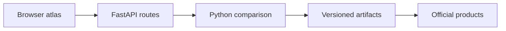
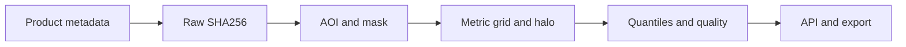

# AlterEcho System and Research Guide

Team AlterEcho | Research prototype | 15 November 2026

AlterEcho compares exact Earth and planetary terrain windows using traceable elevation measurements. This guide explains the implemented software, its numerical method, reproducibility and limits. Only terrain supports a numerical analogue result; the application does not establish mission suitability or predictive accuracy.

## 1 Project purpose

Shortlist Earth terrain for research and field-method discussions by comparing registered 10 km windows with specific Mars or lunar windows. A high terrain index indicates similarity of two distributions at the tested scale, not comprehensive similarity to a planet.

## 2 NASA challenge connection

The repository identifies Team AlterEcho's NASA Space Apps 2026 challenge as identifying Earth locations analogous to permanent Moon-base locations and Mars. AlterEcho contributes a transparent terrain-comparison prototype. Participation does not imply NASA endorsement, validation or operational approval.

## 3 What AlterEcho does

The atlas serves cached, versioned scientific artifacts. Python performs deterministic measurement, eligibility checks, comparison and ranking. Users can inspect raw measurements, source products, quality limitations, evidence coverage and scenario sensitivity, then export the same backend result used by the interface.

## 4 What AlterEcho cannot establish

DEM similarity cannot establish geology, minerals, soil bearing strength, rock hazards, wheel-scale traversability, construction feasibility, life, habitability, resource abundance, landing safety, radiation safety, access or permits. Regional analogue literature is context or a future validation label, never a numerical input.

## 5 User workflow

Choose Mars or Moon, then a processed reference and task profile. Select a comparable Earth candidate; inspect imagery and terrain at the same ground scale. Read the simple result, evidence coverage and limitations, then open full evidence for equations, distributions, tolerances and source details. Download JSON or open the printable report. The Moon currently offers distances only. Explore screens a new Earth AOI without enrolling it in the atlas.

## 6 System architecture

A Next.js application calls the FastAPI backend. The backend reads the catalog, task configuration and small processed artifacts. Offline acquisition and processing scripts produce immutable source checksums and versioned measurements. A bounded Explore worker obtains approved Earthdata products only when necessary. Provider credentials remain on the server.



## 7 Frontend architecture

App Router pages cover Atlas, Explore, Method, Sources and Report. Typed API clients and keyed hooks load backend responses. Atlas components render candidate lists, synchronized image views, charts and evidence panels. The frontend does not calculate the scientific index. Semantic color tokens support Light, Dark and System; a pre-paint script applies saved preference, while reduced-motion rules suppress transitions.

## 8 Backend architecture

app/main.py installs bounded-body and security-header middleware, CORS and safe exception handlers. Routers separate catalog, historical comparison, current v3 comparison, provenance and Explore. analogue_v1_service orchestrates the current method; analogue_math provides authoritative arithmetic. terrain_quantiles measures rasters. Historical endpoints remain explicitly versioned for reproducibility.

## 9 Processing pipeline

Discover an exact official product, record its metadata, verify access and licence, acquire into ignored raw storage, hash and inspect it, then construct the registered metric window with a processing halo. Resample elevation before computing derivatives. Apply documented masks, compute feature-specific valid coverage and quantiles, and preserve output checksums. A serving request validates the current derived artifact against its checksum and manifest; raw multi-GB files are checked during release reproduction.



## 10 Dataset registry

The source-registry-v1 JSON in backend/data/manifests/acquisition-v1 is the machine-readable release inventory. Its Pydantic model and JSON Schema require source roles, provenance fields, byte counts and checksums. Collection entries describe candidates; product entries audit exact local inputs. Null metadata means not established. Verified denotes recorded metadata and byte integrity, not independent scientific validation. The /api/v3/source-registry endpoint exposes this inventory.

## 11 Earth datasets

SRTMGL1.003 is the primary Earth terrain product, a radar surface model whose postings are about 30 m. NASADEM and Copernicus GLO-30 are sensitivity products, not mixed cells in the primary score. WorldCover v200 supplies a built-up exclusion mask; it misses some industrial terrain. Sentinel-2 L2A is display-only. Existing Aqua MYD11A2.061 thermal measurements are retained as diagnostic context; a Terra MODIS replacement is unnecessary without a defined comparability benefit.

## 12 Mars datasets

Jezero retains the existing USGS Mars 2020 CTX DEM. Gale, InSight, Gusev and Eberswalde retain official controlled CTX stereo DTMs and associated imagery. Their 20 m postings do not guarantee 20 m effective resolution; stereo noise and incomplete pixels matter. MOLA is a coarse context or alignment check. MEDA temperature has rover-point support and does not establish an AOI-wide thermal match. CRISM mineral processing remains unavailable.

## 13 Moon datasets

The registered south-pole window uses a local metres-valued LOLA-derived DEM. Four 2 km reference translations produce a relative-elevation floor too large for the frozen tolerance, so no lunar index or ranking is issued. Track spacing, interpolation and polar projection limit interpretation. Illumination, permanently shadowed regions, alternate lunar DEMs, Diviner temperature and regolith/resource variables are not validated evidence families.

## 14 Registered AOIs

Every row below has a local terrain input and a stored terrain-v5 artifact. Eligibility is conditional on the selected task and reference. The original Atacama window is excluded for industrial contamination; the lunar window is diagnostic. Holuhraun and McMurdo remain planned.

| Site | Longitude | Latitude | Width m | Role |
| --- | --- | --- | --- | --- |
| earth-atacama-south | -69.9005 | -24.2722 | 10000.0 | terrain eligible |
| earth-atacama | -69.9 | -24.2 | 10000.0 | diagnostic or excluded |
| earth-craters-of-the-moon | -113.55 | 43.42 | 10000.0 | terrain eligible |
| earth-danakil | 40.2989 | 14.2417 | 10000.0 | terrain eligible |
| earth-hanksville-mdrs | -110.7919 | 38.4064 | 10000.0 | terrain eligible |
| earth-ladakh | 77.6 | 34.2 | 10000.0 | terrain eligible |
| earth-meteor-crater | -111.0225 | 35.0272 | 10000.0 | terrain eligible |
| earth-upper-mustang | 83.9 | 29.1 | 10000.0 | terrain eligible |
| mars-eberswalde-delta | -33.55 | -23.85 | 10000.0 | terrain eligible |
| mars-gale-aeolis-palus | 137.4417 | -4.5625 | 10000.0 | terrain eligible |
| mars-gusev-plains | 175.4726 | -14.5684 | 10000.0 | terrain eligible |
| mars-insight-elysium | 135.6234 | 4.5024 | 10000.0 | terrain eligible |
| mars-jezero | 77.45 | 18.44 | 10000.0 | terrain eligible |
| moon-south-pole-shackleton | 0.0 | -90.0 | 10000.0 | diagnostic or excluded |

## 15 Imagery and evidence roles

Scored evidence, diagnostic evidence, quality masks, display imagery, research context and planned evidence have distinct roles. Sentinel true colour, CTX orthoimages and globe textures never enter terrain arithmetic. Source imagery is not recolored by the theme. Imagery timestamps come from metadata; latest context is archived acquisition, not a live measurement. Scene cloud coverage differs from AOI cloud/shadow/snow and footprint coverage.

## 16 Native resolution and analysis grid

Native pixel spacing is retained separately from the shared 60 m analysis grid. A nominal 10 km square requires ceil(10000/60) = 167 cells, hence 10020 m actual raster support. The 120 m and 240 m grids are scale scenarios. Earth uses local UTM, Mars a product-appropriate metric planetary projection, and the lunar pole a polar projection. Relative elevation subtracts each window median; absolute heights with unlike vertical references are not compared.

## 17 Data quality gates

Both sides must measure the same construct in compatible units, on the same grid and support with valid coverage at least 0.9. Required scored features must have finite ordered 500-quantile distributions. Source/body/AOI identity, official source URL, source checksum chain and derived checksum must agree. Future processing dates, fixture inputs and invalid coordinates are rejected. Missing data reduce coverage and never become zero similarity. Unknown effective resolution and product-label metadata remain review limitations.

## 18 Implemented equations

The production calculation approximates Wasserstein distance using 500 midpoint samples of empirical inverse CDFs, rounded to four decimals in the measurement artifact. It does not compute an exact integral over every raw cell at serving time. Scalar differences preserve their physical units. The transform is a project-defined index, not a calibrated probability.

$$
\mathcal{Q} = (E,\,P,\,T,\,H,\,V,\,R)
$$

$$
\theta = \arctan\sqrt{\left(\frac{\partial z}{\partial x}\right)^{2} + \left(\frac{\partial z}{\partial y}\right)^{2}}
$$

$$
z_{\mathrm{rel}} = z - \operatorname{median}(z)
$$

$$
d_{k} = \left| x_{E,k} - x_{P,k} \right|
$$

$$
d_{k} = W_{1}\!\left(F_{E,k}, F_{P,k}\right) = \int_{0}^{1} \left| F_{E,k}^{-1}(u) - F_{P,k}^{-1}(u) \right| \mathrm{d}u
$$

$$
\hat{d}_{k} = \frac{1}{N}\sum_{i=1}^{N} \left| Q_{E,k}(u_{i}) - Q_{P,k}(u_{i}) \right|, \qquad u_{i} = \frac{i - \tfrac{1}{2}}{N}, \quad N = 500
$$

$$
s_{k} = \exp\!\left[-\ln 2\,\left(\frac{d_{k}}{\tau_{k}}\right)^{2}\right]
$$

$$
\tau_{k} = \operatorname*{median}_{i<j} W_{1}\!\left(F_{i,k}, F_{j,k}\right)
$$

$$
S_{g} = \sum_{k} a_{k|g}\, s_{k}, \qquad \sum_{k} a_{k|g} = 1
$$

$$
\delta_{k} = \sqrt{\delta_{\mathrm{place},k}^{2} + \delta_{\mathrm{dem},k}^{2}}
$$

$$
A_{\mathrm{obs}} = 100 \times \frac{\sum_{g} w_{g} I_{g} S_{g}}{\sum_{g} w_{g} I_{g}}
$$

$$
C = \sum_{g} w_{g} I_{g}
$$

## 19 Mathematical symbols

E is the exact Earth AOI; P the reference AOI; T the task; H the epoch/process context; V the processing and scoring version; R the profile configuration. k indexes features and g evidence families. d is a physical distance, tau a material-difference tolerance in the same units, delta a tested resolution floor, s a feature similarity, a a within-family weight, w a planned family weight, I family eligibility, S a family score, A_obs the observed index and C evidence coverage. u is cumulative probability in the empirical quantile functions. The eligibility key includes a profile-configuration digest and a stated present-surface epoch.

## 20 Weights and tolerances

Only slope and relative-elevation distributions are scored, with weight 0.50 each. Relief and roughness have zero scoring weight because of redundancy. The current exact tolerances and worked measurement values below are generated from the backend paper data.

| Feature | Distance | Tolerance | Similarity | Weight |
| --- | --- | --- | --- | --- |
| slope | 0.8224898 | 5.8058 | 0.986185184 | 0.5 |
| relative_elevation | 15.6373118 | 77.1038 | 0.97189252 | 0.5 |

## 21 Tolerance derivation

Tolerances are medians of pairwise Earth-window terrain distances at each scale. The background contains 88 non-overlapping windows from four regions, taken from source tiles already acquired for known candidates. Windows are separated but not statistically independent; geography and prior candidate selection can bias calibration. Leave-one-region-out sensitivity does not constitute independent blind validation. No expert-derived boundary or measurement uncertainty is claimed for tau.

## 22 Resolution floor

For each feature and reference, the floor combines the largest tested 2 km north/south/east/west reference-placement distance with the frozen Earth DEM-product difference in quadrature. A feature must satisfy tau >= 3 delta. The floor affects eligibility and interpretation; it does not subtract a distance or boost a score. Candidate differences below the floor are not resolved by the tested data and scenarios.

## 23 Ties and ranking

Scenario ranges include candidate placement, reference placement, DEM choice, scale, tolerance and weight changes. Overlapping ranges are grouped. The atlas shows no rank numbers: sites are listed by terrain class (same class when every scored distance is below its tolerance, different when every one is above it) and, inside a class, sites whose ranges overlap are not put in order. The API still returns competition ranks for reproducibility. Only the terrain profile is compared, and only within one reference/profile/configuration/eligibility identity. Overlap expresses unresolved ordering under tested scenarios, not equal terrain or a confidence interval.

## 24 Evidence coverage and task gates

Coverage is the fraction of the planned family weight that has compatible evidence. It is neither pixel coverage nor confidence. Terrain analogy can reach coverage 1 while excluding all non-terrain questions. Balanced science requires geology; rover mobility requires physical field suitability; biosignature fieldwork requires geochemical and preservation evidence; base field testing requires thermal and field evidence. Failed critical gates now produce a null overall API/export index and no scenario index. Measured family details remain visible.

## 25 Worked real calculation

The generated full-precision Atacama-south/Jezero result is 97.903885; the API and display use 97.90. The independent reference arithmetic agrees. Recombining rounded display similarities can differ slightly. The all-cell Wasserstein check differs from the 500-quantile approximation by less than 0.1 percent in this example; this is an approximation check, not predictive accuracy.

## 26 Reliability and discrimination

Against Jezero, 49% of the 88 ordinary windows score 90 or more (median 87.4), so every result is shown with its standing: how many of those ordinary windows it beats (Atacama: 73 of 88). High scores are common among smooth low-relief terrain. Distribution comparisons ignore the spatial arrangement of channels, ridges and hazards; a gentle synthetic control can score highly. Synthetic controls belong to method diagnostics, never production candidate evidence. No independently labelled accuracy percentage is available.

## 27 Sensitivity testing

The committed evaluation contains AOI/reference translations, alternative DEMs, 60/120/240 m grids, leave-one-feature-out comparisons, tolerance and weight variations, background score distributions and leave-one-region-out calibration. The release reproduction recomputes every registered primary-grid scored quantile from local rasters. Alternative DEM scenario coverage is incomplete for Meteor Crater after a recorded provider rate limit. Expert-labelled positives, negatives and process-specific validation remain future work.

## 28 Security controls

Catalog IDs constrain file access. Source hosts are allowlisted; acquisition strips credentials on cross-host redirects, bounds downloads and extraction, and uses timeouts. API bodies are capped at 32768 bytes even without Content-Length and have a 15 second receive deadline. Explore has queue and rate limits. Responses sanitize validation and server errors; production disables interactive API documentation. The tracked-file credential scan and dependency audits are repeatable, but cannot prove the absence of vulnerabilities. A reverse proxy must enforce deployment-wide rate and resource limits.

## 29 API reference

Current comparison endpoints are GET /api/v3/compare, /api/v3/result, /api/v3/references, /api/v3/profiles, /api/v3/method, /api/v3/data-roles, /api/v3/sites/{site_id}/explorer and /api/v3/source-registry. Comparison query parameters are reference and profile; result also requires site. Validation failures return structured errors. The complete generated OpenAPI inventory is docs/api-reference.json. Historical endpoints carry their historical method versions and should not be mixed with v3 rankings.

## 30 Repository structure

frontend/app contains pages and components; frontend/lib the typed client and response types; frontend/e2e browser tests. backend/app/data holds versioned catalog and method configuration, models schemas, services scientific logic, routers API endpoints and scripts repeatable operations. backend/data/aoi stores exact registered windows; manifests source provenance; processed measurements, imagery, evaluation and evidence. Raw/interim/cache/job storage is ignored. docs/paper contains generated methods and worked results.

## 31 Local setup

Create a fresh Python environment rather than copying a virtual environment between machines. Python 3.12 or 3.13 and Node 20 or newer are documented prerequisites. This review used the working ignored .venv-local environment; the copied .venv-geo pointed to a different user's missing interpreter.

```text
cd backend
python -m venv .venv-local
.venv-local/Scripts/python.exe -m pip install -r requirements-dev.txt
.venv-local/Scripts/python.exe -m uvicorn app.main:app --host 127.0.0.1 --port 8000
# separate terminal
cd frontend
npm ci
npm run dev
```

## 32 Environment variables

APP_ENV controls production API documentation. CORS_ORIGINS lists explicit browser origins. NEXT_PUBLIC_API_BASE_URL points the browser at the backend; NEXT_PUBLIC_BUILD_IDENTIFIER helps detect stale builds. ALTERECHO_PYTHON selects the interpreter used by Playwright. EARTHDATA_TOKEN or EARTHDATA_USERNAME and EARTHDATA_PASSWORD are backend-only credentials read from environment or ignored local .env. Never put credentials in NEXT_PUBLIC variables, reports, signed-URL manifests or tracked configuration.

## 33 Data acquisition

Retain verified existing products. SRTM acquisition requires Earthdata credentials only for uncached protected products; do not fabricate a replacement if access fails. Mars CTX uses official STAC discovery and controlled window reads. Lunar LOLA processing follows its archived label and conversion script. Preserve raw products separately from local crops. Detailed source-specific commands and known gaps are in DATA_ACQUISITION_GUIDE.md.

```text
cd backend
python -m app.scripts.acquire_dataset --source-id earth-atacama-south-srtmgl1
python -m app.scripts.register_mars_references
python -m app.scripts.register_lunar_reference
```

## 34 Reproduction commands

The first two commands below inspect and reproduce existing measurements without replacing scientific artifacts. Calibration and reference regeneration commands are documented separately because they write versioned outputs; review their diff before accepting a new release.

```text
cd backend
python -m app.scripts.audit_sources --write
python -m app.scripts.reproduce_release
python -m app.scripts.build_methods_paper
python -m app.scripts.build_system_guide
```

## 35 Test commands

Tests distinguish arithmetic, data integrity, API behavior, browser workflows and external-provider availability. A passing suite does not independently validate terrain science. The release handoff records actual results rather than a permanent claim that tests always pass.

```text
cd backend
python -m pytest -q
python -m app.scripts.validate_catalog_integrity
python -m app.scripts.release_security
python -m pip_audit
# PowerShell live provider checks
$env:ALTERECHO_LIVE='1'; python -m pytest tests/test_live_providers.py -q
cd ../frontend
npm run lint
npx tsc --noEmit
npm run build
$env:ALTERECHO_PYTHON='.venv-local\Scripts\python.exe'
npm run test:e2e
npm audit
```

## 36 Deployment

No deployment is performed by this release review. Serve the API behind HTTPS and a reverse proxy with explicit allowed origins, request limits and operational monitoring. Serve the production Next.js build, mount the approved small processed artifacts and isolate optional acquisition jobs. Set APP_ENV=production, verify the configured browser/API origins, then run smoke tests against the actual deployment. No user accounts are needed for the current public atlas.

## 37 Attribution and licences

SRTM, NASADEM and mission products retain NASA/JPL/PDS attribution; controlled USGS CTX products cite DOI 10.5066/P9JKVWR3 and their CC0 terms. Sentinel imagery contains modified Copernicus Sentinel data. WorldCover v200 is attributed under CC-BY-4.0. Copernicus GLO-30 attribution includes DLR, Airbus and EU/ESA. OpenStreetMap/OpenFreeMap supply display basemap context. Exact terms and product links are in the source registry; permission to use a data product is separate from land access.

## 38 Current limitations

The prototype has traceable terrain results but lacks independent scientific validation. Low-relief saturation, calibration geography, distribution-only descriptors, stereo noise, imperfect land-cover masks, unknown effective resolution and incomplete product-label metadata limit interpretation. Thermal constructs have mismatched spatial and temporal support; minerals, resources and field constraints remain diagnostic or unavailable. Original Atacama is excluded; lunar distances do not constitute a scored analogue result.

## 39 Future scientific validation

Obtain an independently labelled evaluation set with accepted process-specific analogues, partial analogues, same-region mismatches and separated negative controls. Preregister AOI and tolerance selection, then assess discrimination, false positives and geographic transfer without calibration leakage. Add a spatial descriptor only with a new method version and redundancy analysis. Thermal or mineral families require compatible physical quantities, quality flags, support and reproducible specialist processing on both bodies.

## 40 References

Primary scientific references are the exact products and papers in the registry and generated methods paper. Useful official entry points include NASA CMR (https://cmr.earthdata.nasa.gov/search/site/docs/search/api.html), USGS CTX DTM documentation (https://stac.astrogeology.usgs.gov/docs/data/mars/ctxdtms/), NASA PDS LOLA (https://pds-geosciences.wustl.edu/missions/lro/lola.htm) and the Microsoft Planetary Computer STAC API (https://planetarycomputer.microsoft.com/api/stac/v1). NASA Analog Explorer supplies research context, not numerical proof of similarity.
